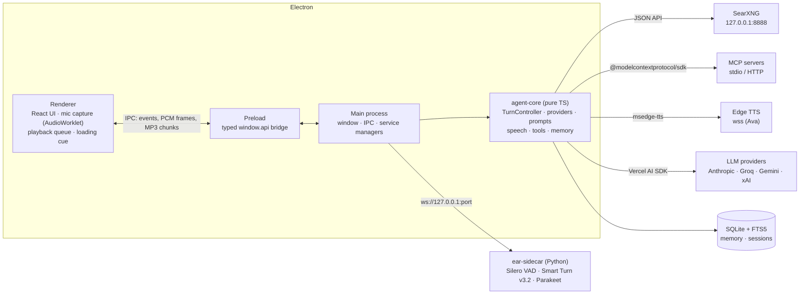
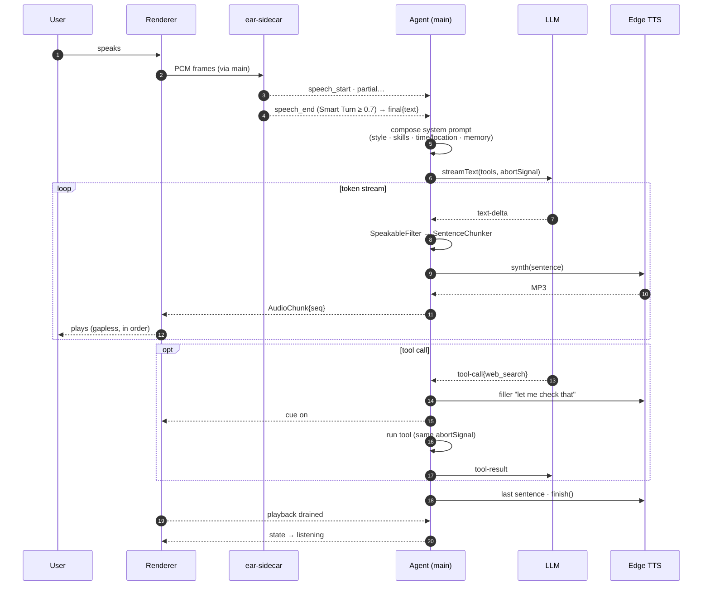
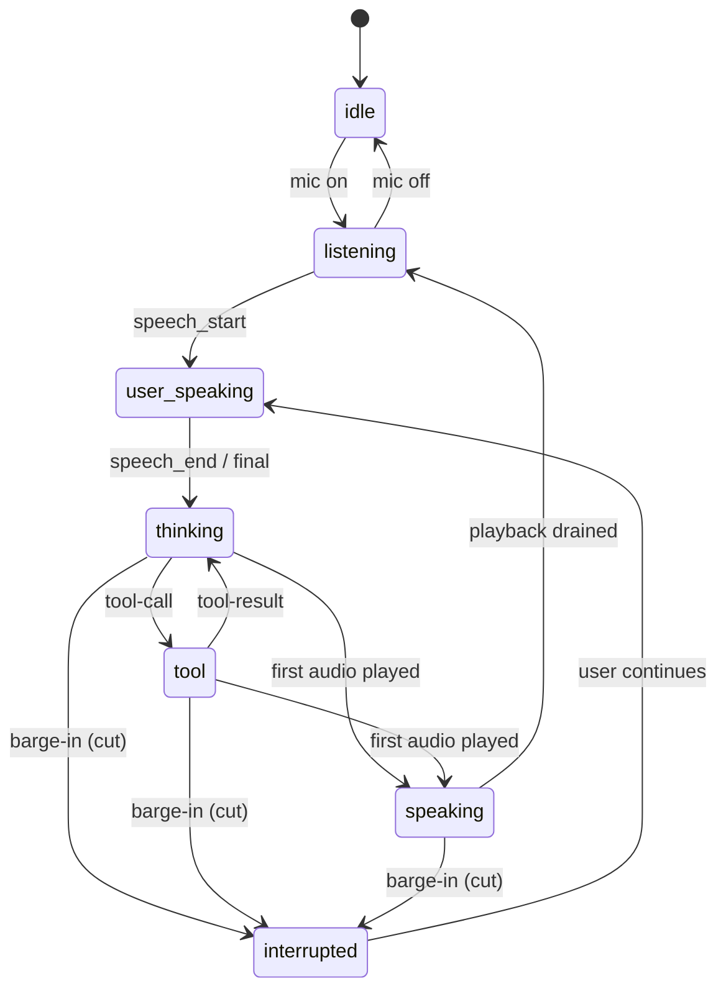
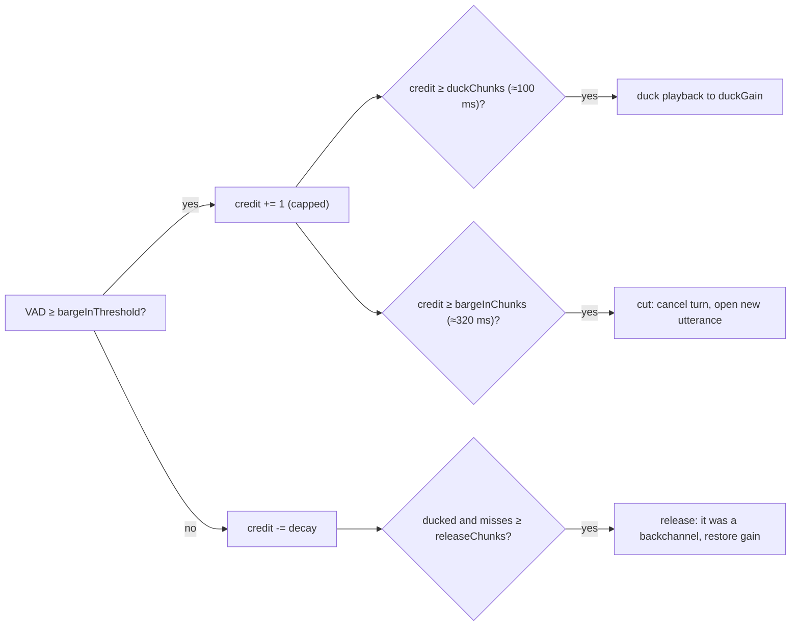
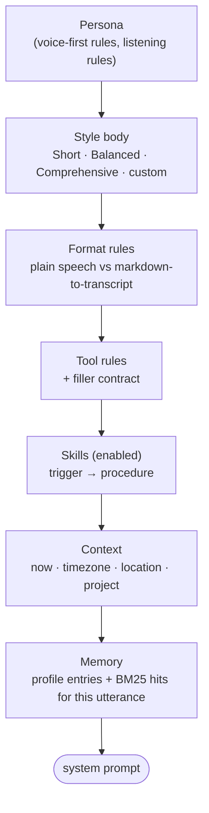
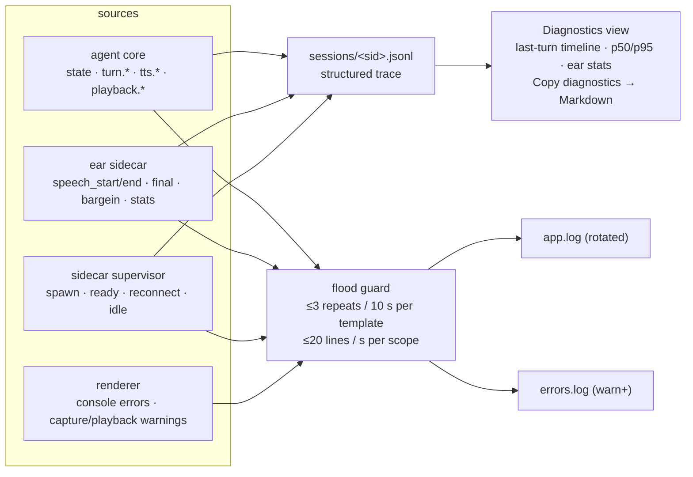
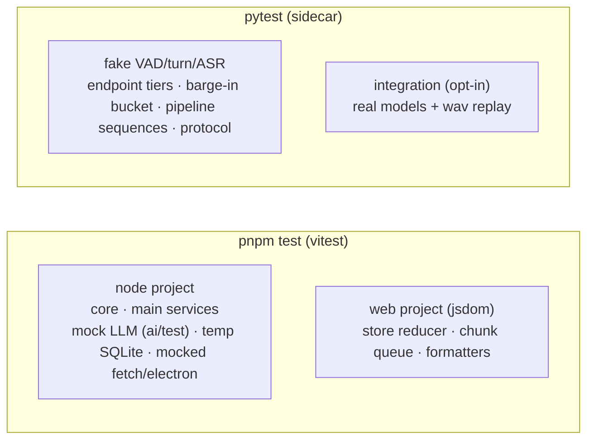

# Architecture

Voice Agent is an Electron desktop app whose brain is TypeScript and whose ears are a small Python
sidecar. This page is the map: processes, the life of one voice turn, how an interruption cancels
everything, and where each concern lives. The planning history is in
[../NEW_ARCHITECTURE.md](../NEW_ARCHITECTURE.md); the ear protocol is in
[../sidecar/PROTOCOL.md](../sidecar/PROTOCOL.md).

## Processes

Everything outside the Electron box is a child process or a network service owned and supervised
by the main process. The renderer never talks to them directly.

| Concern | Where | Notes |
|---|---|---|
| Mic capture, device choice, AEC | `src/renderer/src/audio/capture*.ts` | Chromium's echo cancellation replaces the old cross-correlation echo gate. 16 kHz int16 frames. |
| Playback, ducking, ordering | `src/renderer/src/audio/playback.ts`, `chunk-queue.ts` | Chunks are MP3 per sentence; a pure `ChunkQueue` guarantees seq order and terminal markers. |
| Speech detection, end-of-turn, ASR, barge-in credit | `sidecar/ear/*` | Ported from the proven Python agent; magic numbers are config sent at connect time. |
| One turn: LLM stream → sentences → TTS → chunks | `src/core/turn/runner.ts`, `src/core/speech/*` | One `AbortSignal` per turn reaches every I/O. |
| Orchestration, state machine, sessions | `src/core/agent.ts`, `src/core/turn/state-machine.ts` | No Electron imports; unit-tested with mocks. |
| Providers, keys, fallback | `src/core/providers/*` | Model id strings `provider:model`; Groq key pool rotates on 429. |
| Prompts, styles, skills, speakable text | `src/core/prompts/*` | Style = full prompt body + length/format; skills are injected procedures. |
| Tools | `src/core/tools/*` | `web_search`/`read_page`/`research`, memory tools, `current_time`, MCP adapter. |
| Memory, sessions, projects | `src/core/memory/store.ts` | `node:sqlite` + FTS5 BM25; scopes = global + one per project. |
| Services | `src/main/services/*` | sidecar supervisor, SearXNG manager, MCP manager, settings + encrypted keys. |

## One voice turn

Measured on the reference machine (RTX 4090, Claude Haiku 4.5): end of speech → transcript
≈ 100 ms, → first audio ≈ 1.1–1.7 s.

## Interruption

Barge-in has to cancel *everything*, not just the audio. The sidecar decides, the agent cancels.

While the agent is speaking the sidecar runs a leaky-bucket credit on speech probability:

On `cut` the agent aborts the turn's `AbortController`. That single signal is threaded into the
LLM stream, every tool call (SearXNG `fetch`, MCP `callTool` → `notifications/cancelled`), the Edge
TTS sockets, the filler and loading cue, and the renderer's playback queue. The partially spoken
reply is kept in the transcript marked *interrupted*, with `spokenText` set to the sentences that
actually played, so the next model call sees what the user really heard.

## Prompt composition

Every turn rebuilds the system prompt from parts, so switching style or toggling a skill takes
effect immediately:

For markdown styles, `SpeakableFilter` runs on the token stream before the sentence chunker: fenced
code becomes "the code is in the conversation", lists and links are flattened for the voice, and the
transcript keeps the full markdown.

## Error policy

| Failure | Behaviour |
|---|---|
| Utterance too short / empty transcript | Dropped silently; stays listening. |
| Sidecar crash / CUDA missing | Restart with backoff (1 s, 3 s, 10 s); exit code 3 → "switch STT to CPU" hint. Typed chat keeps working. |
| No first token in 8 s, stall > 8 s (25 s during a tool) | Retry once on the same model → one turn on the fallback model → spoken notice. If text was already spoken, keep it and note the cut. |
| Provider 429 (Groq) | Key pool benches the key for 60 s and rotates. |
| Tool error / SearXNG down | Returned to the model as an error string; pill turns amber; one `ensureRunning()` attempt first. |
| Edge TTS failure | Retry the sentence once → skip it → after 3 consecutive failures, system voice for the rest of the turn + one toast. |
| Barge-in during a tool | Same cancel path; late tool results are discarded by turn id. |

## Observability

Every behavioural number is a documented tuning parameter (`src/shared/tuning.ts`,
[TUNING.md](TUNING.md)); every turn is reconstructible from the session trace
(`logs/sessions/<sessionId>.jsonl`, [DEBUGGING.md](DEBUGGING.md)).

Per-frame data (VAD levels) never reaches disk. Transcript text can be redacted from the trace with
`runtime.logTranscripts`.

## Testing

CI runs the TypeScript suite on Windows and the Python unit suite on Linux without torch or a GPU.
